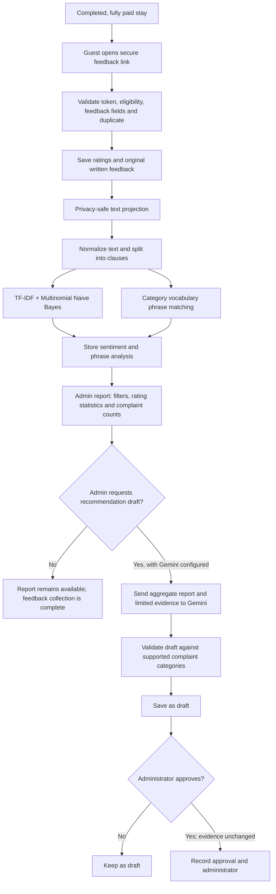

# The Villa AI-Based Feedback Analysis Pipeline

## What “AI-based” means in this system

The pipeline is a **hybrid feedback-analysis workflow**, not one AI model that
does everything:

1. A trained **TF-IDF + Multinomial Naive Bayes** model estimates sentiment
   (negative, neutral, or positive).
2. **Rule-based phrase matching** assigns a complaint topic, such as pool
   cleanliness or internet connectivity. These rules do not determine
   sentiment.
3. Optional **Gemini** creates administrator-facing recommendation drafts from
   aggregated analysis. Gemini does not classify the original feedback, and it
   does not carry out the recommendations.
4. An administrator reviews and explicitly approves a draft. Approval records
   a review decision; it does not create or execute an operational task.

The analysis is experimental and requires human review. Star ratings and
written-text sentiment are handled separately.

## End-to-end flow

## Detailed stages

### 1. Collect and protect feedback

The normal guest-submission flow is tied to a completed, fully paid stay. A
secure feedback token is checked before submission, and the database submission
procedure validates eligibility again and prevents duplicate submissions.
Written comments and the separate star-rating fields are saved as the source
feedback; the analysis is not allowed to replace or retrain itself from those
predictions.

For model input, the application builds a privacy-safe projection of the
comment. It hides guest identity and excludes booking tokens, booking
associations, contact details, and private notes. Ratings can be used as
separate descriptive report statistics, but they are **not** used as sentiment
labels or model features.

Historical feedback can also be included in administrator reports. It is
selected as historical source data and is not represented as a new verified
guest submission.

### 2. Normalize text and split clauses

The versioned preprocessing step applies Unicode normalization, case folding,
whitespace cleanup, and a small explicit correction list for known misspellings
and variants. It does not translate text or run a general-purpose spellchecker.
Original comments remain unchanged.

Comments are conservatively split at punctuation and selected contrast terms
such as “but” and “pero.” The limit is 80 clauses per review. Each clause keeps
both its original text for evidence and a normalized form for analysis. Clause
splitting is heuristic: a clause can omit the subject that appeared earlier in
the sentence, so a topic or sentiment may be missed or attributed imperfectly.

### 3. Estimate sentiment with the trained model

The saved local model applies TF-IDF text features and Multinomial Naive Bayes
to estimate one of three labels for the full comment and for each clause:
**negative**, **neutral**, or **positive**. The production artifact and model
version are loaded by the backend; the training and evaluation datasets are
development inputs, not live feedback.

If the text contains no features known to the model, sentiment is left
unclassified rather than forcing a majority-class prediction. Returned class
scores are not calibrated confidence values. Predictions are marked as pilot
analysis and require human review.

### 4. Match complaint topics with rules

Separately, the category matcher checks normalized clause text against the
regular-expression vocabulary in
[`backend/ml/categories.json`](../backend/ml/categories.json). Examples of
categories include pool cleanliness, air conditioning, internet connectivity,
staff service, and bathroom cleanliness.

This is the **rule-based** step: fixed patterns assign possible topics. It is
not the Naive Bayes model, and it is not Gemini. The vocabulary is provisional;
literal patterns can miss paraphrases, misunderstand context, or produce a
match that needs review.

For the complaint report, a matched topic contributes only when its clause is
classified as negative. A review is counted at most once per topic even if it
repeats the issue, and one review may count toward multiple topics. The report
retains a small number of example snippets as evidence. Positive staff praise
does not automatically count as a staff complaint.

### 5. Persist and refresh the analysis

On a new valid submission, the application attempts pilot analysis after the
feedback is saved. A separate backend worker also checks feedback periodically
(normally every 60 seconds) and reprocesses rows when the model version,
preprocessing version, or privacy-safe input hash changes. This makes updated
analysis independent of an administrator opening the page.

The stored analysis includes model/pipeline versions, input hash, analysis
time, sentiment output, and clause-level phrase analysis. If analysis fails,
the original feedback remains saved and the worker can retry; failure of the
pilot does not reject or erase the guest submission.

### 6. Build administrator reports

An authenticated administrator can request an analysis report and filter by
feedback source, villa, rating, and date range. The report combines:

- counts and averages derived from star ratings;
- sentiment counts derived from written text;
- complaint-topic frequencies and supporting snippets;
- source and time-trend summaries.

The rating statistics and text model output remain distinct. The report's
complaint counts are heuristic results, not verified incident counts. The
backend also fingerprints the evidence and model version so it can detect
whether a recommendation draft has become stale.

### 7. Optionally draft recommendations with Gemini

Gemini is called only when an administrator requests recommendations and the
provider is configured. The request contains aggregate review/rating
statistics and bounded complaint evidence, not guest identity, contact details,
booking tokens, or private notes.

The backend validates the structured response and rejects duplicate or
unsupported complaint categories. Counts and evidence in the saved result are
taken from the server report, not generated by Gemini. The result is stored as
a **draft** with its evidence fingerprint and model version.

If Gemini is not configured or available, feedback submission, sentiment
analysis, complaint reports, and rating summaries still operate; only Gemini
draft generation is unavailable.

### 8. Require administrator review

An administrator reviews the draft and may approve it. Before approval, the
backend recomputes the underlying report and compares its fingerprint with
the draft's fingerprint. If the feedback or model has changed, approval is
rejected and a fresh draft must be generated and reviewed. Successful approval
records the administrator and timestamp.

Approval does not verify that a complaint is true, create a staff task, or
execute a suggested action. It is a human review status only.

## Current limitations

- Complaint categories use a provisional hand-maintained vocabulary and may
  miss synonyms, context, mixed language, or unseen topics.
- Clause splitting can lose context, and sentiment predictions can be wrong.
- The model is a pilot trained on a small labeled dataset; evaluation results
  are not production accuracy guarantees. See
  [`CHAPTER_4_AI_EVALUATION.md`](./CHAPTER_4_AI_EVALUATION.md) for the dataset,
  validation design, results, and evaluation limits.
- Gemini output is a suggestion, not a finding or an autonomous action.
- Human review is required throughout interpretation and before recommendation
  approval.

## Implementation references

- Feedback eligibility, safe input, and privacy projection:
  [`backend/feedback_policy.py`](../backend/feedback_policy.py),
  [`backend/booking.py`](../backend/booking.py)
- Text preprocessing and phrase categories:
  [`backend/ml/preprocessing.py`](../backend/ml/preprocessing.py),
  [`backend/ml/complaints.py`](../backend/ml/complaints.py),
  [`backend/ml/categories.json`](../backend/ml/categories.json)
- Sentiment model and persistence:
  [`backend/ml/naive_bayes.py`](../backend/ml/naive_bayes.py),
  [`backend/ml/inference.py`](../backend/ml/inference.py)
- Periodic re-analysis and administrator report:
  [`backend/feedback_automation.py`](../backend/feedback_automation.py),
  [`backend/feedback_analysis.py`](../backend/feedback_analysis.py)
- Gemini draft and administrator approval:
  [`backend/ml/recommendations.py`](../backend/ml/recommendations.py),
  [`backend/admin.py`](../backend/admin.py)
