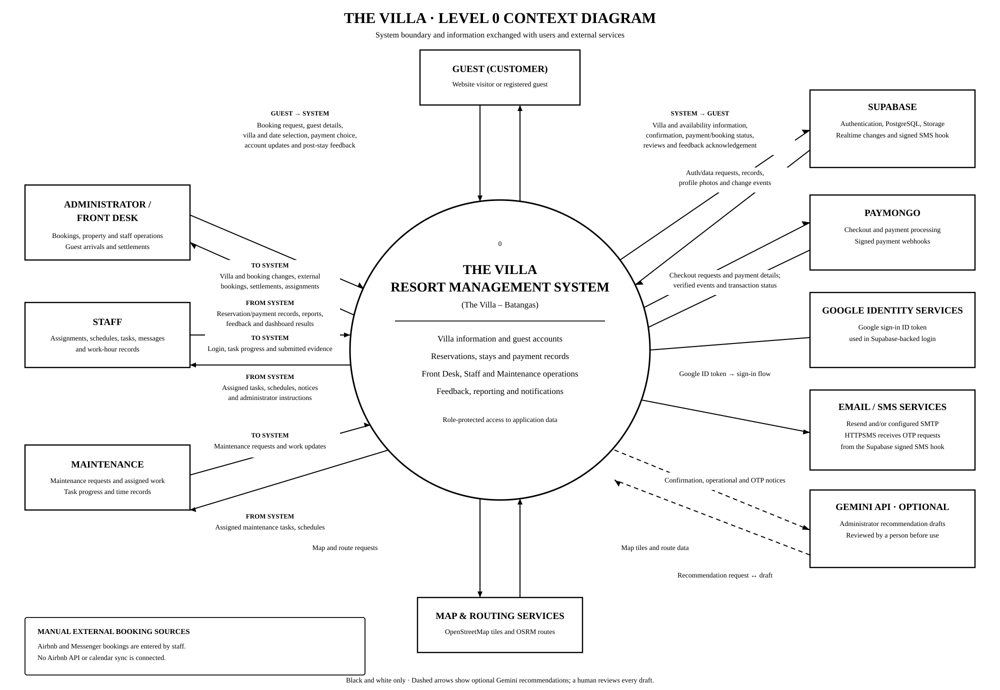

# The Villa system context diagram

Following the supplied Level 0 diagram as a design reference, this view places
The Villa's numbered system process at the center, with human actors and
external services around it and labeled information flows between them. The
application is served from the Render-hosted React and FastAPI service;
provider integrations depend on deployment configuration.

## System boundary and information flows

- **Guest:** searches villa information, submits reservation and account details,
  chooses a payment method, and provides feedback. The system returns villa and
  availability information, booking/payment status, confirmations, and feedback
  access.
- **Administrator:** manages villa information, pricing, reservations, staff,
  and feedback decisions; receives operational records and reports.
- **Front Desk:** records walk-ins, stay changes, and payment settlements; uses
  arrival, balance, receipt, and readiness information.
- **Staff and Maintenance:** receive assignments, schedules, and notices; send
  task, maintenance, message, and work-hour updates.
- **Supabase:** supplies authentication, PostgreSQL data, Storage, and Realtime
  change events. Realtime changes become role-scoped SSE invalidation signals;
  clients reload data through authorized APIs.
- **PayMongo:** receives checkout-session requests and sends payment webhooks
  whose signatures are verified by the application.
- **Google Identity Services:** provides the ID token used in the
  Supabase-backed sign-in flow.
- **Email providers:** deliver supported messages through Resend over HTTPS
  and/or configured SMTP.
- **SMS provider:** Supabase sends a signed OTP hook to the Villa API, which
  forwards delivery requests to HTTPSMS.
- **Map and routing services:** the guest's browser requests OpenStreetMap map
  tiles and OSRM route data.
- **Gemini (optional):** can return recommendation drafts for administrators.
  A person reviews suggestions; the integration does not execute operational
  changes.

## Scope notes

Airbnb and Messenger are not directly integrated with The Villa. Staff manually
record bookings from those channels; there is no Airbnb API or calendar sync.
The context diagram therefore does not show either channel exchanging data
directly with the application.

The diagram represents system boundaries and major data flows, not every API
route or database table. Sentiment analysis is a local pilot classifier and is
not represented as an external service.

## Related documentation

- [System architecture](./SYSTEM_ARCHITECTURE.md)
- [Level 1 data flow diagram](./LEVEL_1_DIAGRAM.md)
- [Render deployment](./RENDER_DEPLOYMENT.md)
- [Use-case diagram](./USE_CASE_DIAGRAM.md)
