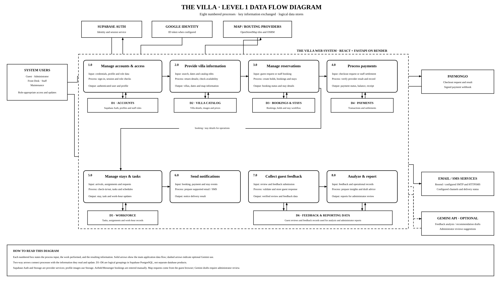

# The Villa Level 1 data flow diagram

This Level 1 DFD decomposes the single Level 0 system process into eight
application processes and the main logical data stores. It follows the
previous diagram's process breakdown while clarifying what information enters,
what each process does, and what it returns. The processes group current
React/FastAPI application behavior; they are not separate deployable services.

## Process and data-store guide

1. **Manage accounts and access:** authenticate users, refresh sessions, check
   roles, and return profile information. Google ID-token sign-in and phone
   sign-in are available when configured.
2. **Provide villa information:** return villa details, images and prices;
   check availability and accept catalog changes. Map tiles and routes are
   requested directly by the guest's browser.
3. **Manage reservations:** create or update guest and staff bookings, manual
   holds and walk-ins; return reservation status and stay details.
4. **Process payments:** create PayMongo checkouts, verify payment webhooks,
   record cash/QR Ph settlements, and return payment status and receipts.
5. **Manage stays and tasks:** handle arrivals and departures, staff
   assignments, Maintenance requests, schedules, and work-hour updates.
6. **Send notifications:** prepare supported booking, payment, stay, and
   feedback notices; pass them to configured email/SMS providers.
7. **Collect guest feedback:** accept and validate guest reviews and feedback
   submissions.
8. **Analyze and report:** use feedback and operational records for reports
   and optional recommendation drafts. Administrators review suggestions
   before use.

- **D1 Accounts:** Supabase Auth identities, profiles, and staff roles.
- **D2 Villa Catalog:** villa details, images, and prices; images use Supabase
  Storage.
- **D3 Bookings and Stays:** bookings, holds, and stay workflow data.
- **D4 Payments:** payment transactions and settlement records.
- **D5 Workforce:** tasks, assignments, and work-hour records.
- **D6 Feedback and Reporting Data:** guest feedback used for analysis and
  administrator reports.

The diagram shows notifications as a process and external delivery service,
not as a separate database product or an assumed notification-outbox store.
Process-to-store arrows are two-way to show that processes read and update
their related records.

These are logical data groupings, not separate database products. Supabase
provides the application’s PostgreSQL database and supporting Auth, Storage,
and Realtime services.

## Scope and boundaries

Airbnb and Messenger bookings are entered manually by staff; no Airbnb API or
calendar sync is connected. Map requests are made from the guest browser.
Gemini is optional, and recommendation drafts require administrator review.
Provider flows are shown only for integrations present in the code and depend
on deployment configuration.

## Related documentation

- [Level 0 context diagram](./CONTEXT_DIAGRAM.md)
- [System architecture](./SYSTEM_ARCHITECTURE.md)
- [Use-case diagram](./USE_CASE_DIAGRAM.md)
