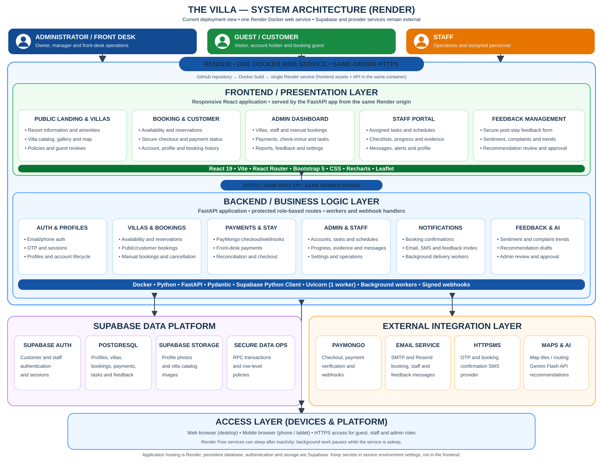

# The Villa system architecture

This diagram summarizes the application structure found in the repository and
the Render deployment used by the project. The Docker image builds the Vite
frontend, packages it with FastAPI, and serves the frontend and API from one
HTTPS origin.

## Reading the diagram

- The React browser application serves public guest pages and role-protected
  Admin, Front Desk, Staff, and Maintenance portals. It calls FastAPI over
  HTTPS; the browser does not use the Supabase service-role key.
- FastAPI owns business APIs, authorization checks, provider callbacks, and
  scheduled background workers. The Render Docker command starts one Uvicorn
  worker; the background workers run in that application process and persist
  their work through Supabase.
- Supabase provides authentication, PostgreSQL, profile-photo storage, and the
  Realtime subscription used by the backend. Realtime changes are converted to
  role-scoped SSE invalidation signals; clients then reload data through
  authorized API requests.
- PayMongo, email delivery (Resend and/or configured SMTP), SMS delivery
  (Supabase's signed SMS hook through the backend to HTTPSMS), Google Identity
  Services, and browser map/routing services are integrations. Their operation
  depends on configuration and provider availability.
- Feedback sentiment uses a local pilot classifier and requires human review.
  Gemini is an optional provider for administrator recommendation drafts; it
  does not execute operational changes.
- Render hosts the combined Docker service: FastAPI serves the built React
  files and API from the same origin. The Azure guide is a separate hosting
  option documented in the repository, not the deployment shown in this
  diagram.

## Related documentation

- [Render deployment](./RENDER_DEPLOYMENT.md)
- [Azure deployment preparation](./AZURE_DEPLOYMENT.md)
- [Entity relationship diagram](./the-villa-erd.svg)
- [System context diagram](./CONTEXT_DIAGRAM.md)
- [Level 1 data flow diagram](./LEVEL_1_DIAGRAM.md)
- [Use-case diagram](./USE_CASE_DIAGRAM.md)
