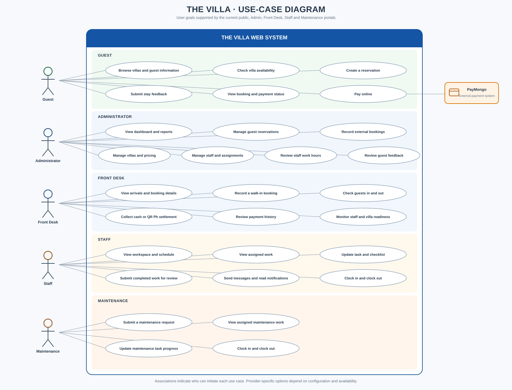

# The Villa use-case diagram

The diagram maps user goals to the current web application. Actors are Guest,
Administrator, Front Desk, Staff, and Maintenance as human actors. PayMongo is
shown separately as an external payment system, not a person.

## Scope and interpretation

- Guest use cases include browsing public villa information, checking
  availability, making a reservation, paying online, checking booking/payment
  status, and submitting stay feedback.
- Administrators manage bookings, external bookings, villa details and pricing,
  staff assignments, work-hour records, and feedback; the dashboard includes
  operational reporting.
- Front Desk use cases cover booking lookup, walk-ins, check-in/out, cash or
  QR Ph settlement, payment history, and staff/readiness monitoring.
- Staff work with assigned tasks, schedules, checklists, messages, notifications,
  review submissions, and work-hour clock-in/clock-out.
- Maintenance staff can submit maintenance requests and manage assigned
  maintenance tasks. They use the Staff portal's schedule and timekeeping
  functions where those are available to their account.
- PayMongo participates in online payment processing. Other configured
  integrations such as Supabase Auth, email, SMS, and Gemini are supporting
  services rather than human actors in this user-goal diagram.

The diagram is a functional summary, not an exhaustive listing of API
operations. Availability of provider-dependent actions depends on deployment
configuration.

## Related documentation

- [System architecture](./SYSTEM_ARCHITECTURE.md)
- [Render deployment](./RENDER_DEPLOYMENT.md)
- [Entity relationship diagram](./the-villa-erd.svg)
